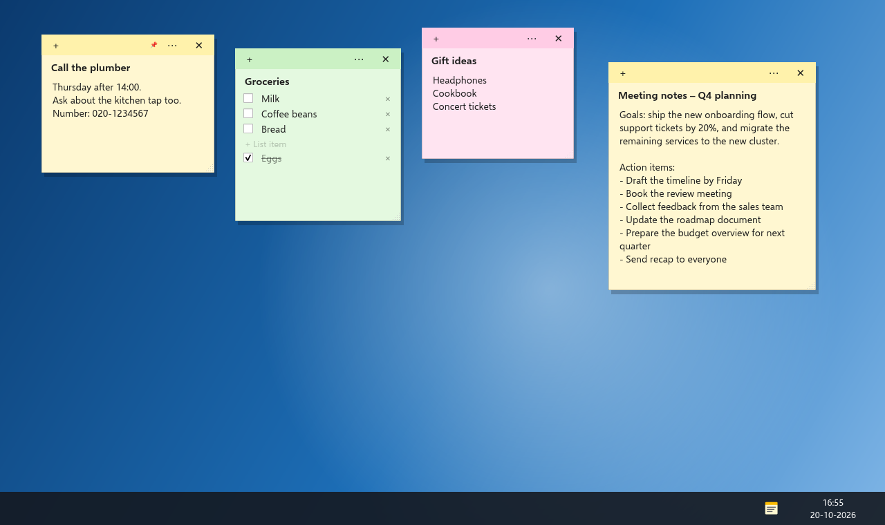
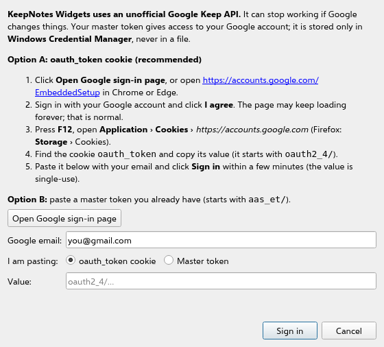
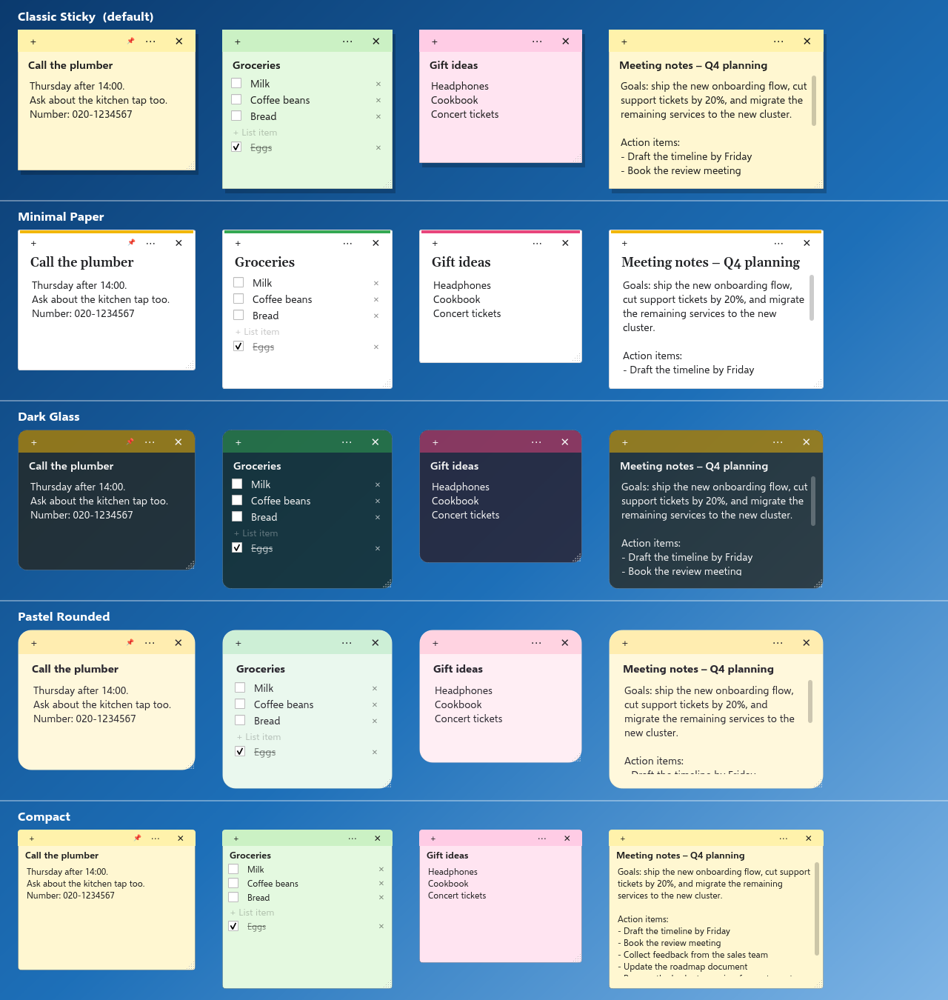

# KeepNotes Widgets

Your Google Keep notes and checklists as small **Windows Sticky Notes-style widgets** on the
desktop, with one widget per note. Edits go both ways: changes you make in a widget are sent to Google
Keep, and changes made in Keep (phone, web) show up in the widgets.



> **Unofficial API warning.** This app uses [gkeepapi](https://github.com/kiwiz/gkeepapi), an
> *unofficial* Google Keep API. Google does not support it and can change or block it at any
> time. If that happens, sync pauses (the tray icon gets an orange pause badge) and your cached
> notes stay visible and editable. Your edits are sent once sync works again.

## Requirements

* Windows 10/11
* Python 3.11 or newer with the `py` launcher. If you don't have Python yet, install it with
  `winget install Python.Python.3.12`.

## Install

**Option 1 (recommended): `install.bat`.** Double-click it. It will:

1. create a private virtual environment in `.venv` next to the app,
2. install the pinned packages from `requirements.txt` (PySide6-Essentials, gkeepapi, gpsoauth,
   keyring),
3. add a Start Menu shortcut called **KeepNotes Widgets**,
4. ask whether to start with Windows. Run `install.bat /startup` to say yes without being asked,
   or `install.bat /quiet` to skip the question.

**Option 2: your system Python.** Run this one line:

```
py -m pip install -r requirements.txt
```

Then start the app with `run.bat`.

`run.bat` uses `.venv` if it exists. Otherwise it uses the system Python, as long as that Python
can import the packages. It starts the app with `pythonw`, so no console window stays open.

## First start: connect your Google account

On first start, the **Connect Google Keep** window opens. You can reopen it later from the tray
icon: **Settings… > Sign in / switch account…**.



Google no longer accepts a plain email + password login for this API, so the app uses the
documented gpsoauth "oauth_token" route:

1. Click **Open Google sign-in page**, or open <https://accounts.google.com/EmbeddedSetup> in
   Chrome or Edge.
2. Sign in with your Google account and click **I agree**. The page may keep spinning
   afterwards; that is normal.
3. Press **F12** to open the developer tools. Go to **Application > Cookies >
   https://accounts.google.com**. In Firefox, go to **Storage > Cookies**.
4. Find the cookie named **`oauth_token`** and copy its **value**. It starts with `oauth2_4/`.
5. In the app, enter your Gmail address, keep **oauth_token cookie** selected, paste the value
   and click **Sign in**. The cookie works only once and expires within minutes, so paste it
   straight away. If you get "BadAuthentication", repeat steps 1 to 5.

The app exchanges the cookie for a long-lived **master token** with
`gpsoauth.exchange_token(email, oauth_token, android_id)` and then logs in with
`keep.authenticate(email, master_token)`.

**Already have a master token?** It starts with `aas_et/`. Choose **Master token** and paste it.

**Where the login is stored:** your email and master token are saved only in **Windows Credential
Manager** (generic credential `KeepNotesWidgets`). They are never written to a file and never
logged. To remove them, use **Settings… > Sign out**, or delete the `KeepNotesWidgets` entries in
*Control Panel > Credential Manager > Windows Credentials*.

## Using the widgets

| Do this | How |
|---|---|
| Move a note | Drag the coloured strip at the top |
| Resize | Drag the grip in the bottom-right corner |
| Edit the title or text | Click and type. Changes are saved about 2 seconds after you stop typing |
| Tick a checklist item | Click its checkbox. Checked items move to the bottom with a strike-through |
| Add a checklist item | Type in **+ List item** and press Enter |
| Delete a checklist item | Click the small **✕** at the end of the item |
| New note | **+** on any note, or tray **New note** / **New list** |
| Colour, pin, always on top | **⋯** menu on the note |
| Hide a note | **✕** in the header. It stays in Keep; bring it back with tray **Show all notes** |
| Move to trash | **⋯ > Move to trash…** asks you to confirm first. You can restore the note from Keep's Trash |

Every widget is **always on top** by default. You can turn this off per note in the **⋯** menu.

### Tray icon menu

* **Status line:** shows "Synced 16:55" when all is well. Otherwise it shows "Sync paused: …
  showing cached notes" or "Not signed in".
* **Sync now**, **Show all notes**, **Hide all notes**, **Toggle all notes**, **New note**, **New list**
* **Settings…:** choose which notes get a widget (all notes, pinned notes only, or notes with one
  label), set the sync interval, sign in, switch account or sign out, and open the data folder.
* **Start with Windows:** adds or removes a shortcut in your Startup folder (`shell:startup`).
* **Quit**

## Templates

**Settings > Template** changes the look of all notes immediately (the drop-down previews live;
Cancel undoes it). The note colours (from Keep or your own per-note choice) work in every template.

| Template | Look |
|---|---|
| **Classic Sticky** (default) | The original Windows Sticky Notes look |
| **Minimal Paper** | White paper, thin border, serif title, a thin colour line on top |
| **Dark Glass** | Dark, slightly see-through notes with rounded corners and a tinted header |
| **Pastel Rounded** | Large rounded corners and soft pastel colours |
| **Compact** | Smaller font and padding, for many notes on screen |



## Global hotkeys

Shortcuts that work in any program, set in **Settings > Global hotkeys** (click a field, press
the combination; the clear button removes it):

| Action | Default |
|---|---|
| Toggle all notes (hide if any is visible, otherwise show all) | **Ctrl+Alt+K** |
| Show all notes | none |
| Hide all notes | none |

A shortcut needs at least two modifiers (for example Ctrl+Alt+…), a Win key combination, or
F13–F24. If Windows or another program already uses it, Settings tells you so and the shortcut
stays inactive until you pick another one. Todoist Widgets uses Ctrl+Alt+T, so the two apps
do not clash.

## How sync works

* The app syncs in the background **every 60 seconds** (you can change this in Settings) and
  **about 2 seconds after each edit**.
* **Conflicts:** if the same note changed both here and in Keep since the last sync, the last
  write wins. The version from Google is kept, a warning goes to the log, and a tray
  notification appears.
* **Offline:** the full note state is cached in `%APPDATA%\KeepNotesWidgets\state.json`. When
  Google can't be reached, you keep seeing and editing the cached notes. Unsynced edits are kept,
  even across restarts, and are uploaded when the connection is back.
* **Colours:** Keep colours are mapped to the Sticky Notes palette. The default is yellow. A
  colour you pick in a widget is always remembered locally in `layout.json`, and the app also
  tries to send it to Keep. gkeepapi has a known issue where colour changes sometimes don't stick
  in Keep; the widget keeps your colour anyway.

## Files

| Where | What |
|---|---|
| `keep_widgets.py` | The app: widgets, tray and dialogs (PySide6) |
| `keep_sync.py` | The sync layer: gkeepapi, offline cache and conflict handling |
| `install.bat`, `run.bat`, `uninstall.bat`, `shortcut.ps1` | Install, start, uninstall and shortcut helpers |
| `win_hotkeys.py` | Global hotkeys (Win32 RegisterHotKey via ctypes, no extra packages) |
| `tests/`, `tools/make_screenshots.py` | Unit tests (a mocked Keep server) and the headless UI test |
| `%APPDATA%\KeepNotesWidgets\layout.json` | Widget position, size, visibility, on-top and colour per note, plus settings |
| `%APPDATA%\KeepNotesWidgets\state.json` | Offline cache of your notes. No password or token |
| `%APPDATA%\KeepNotesWidgets\keepnotes.log` | Log file. Look here if sync pauses |

You can try the look without signing in by running `run.bat --demo`. This shows 4 sample notes
and syncs nothing.

## Uninstall

Quit the app from the tray, then run `uninstall.bat`. It removes the shortcuts and `.venv`. Your
notes are not touched: they live in Google Keep. To remove everything else, delete
`%APPDATA%\KeepNotesWidgets` and the `KeepNotesWidgets` entries in Credential Manager.

## Troubleshooting: nothing starts

If a start does nothing, check the log file in the data folder. Since this version a missing or
broken Python package shows a message box and writes `ERROR Startup failed` to the log instead
of exiting silently. A `.venv` folder left behind by an interrupted `install.bat` is skipped by
`run.bat` and the Start Menu shortcut; run `install.bat` again to repair it, or delete the `.venv`
folder to use your system Python.

## Limitations

* The Keep API is unofficial and may break without warning (see above).
* Images, drawings, reminders, collaborators and nested (indented) checklist items are not shown
  or edited in the widgets. They are left untouched in Keep.
* Archived and trashed notes are not shown.
* With many notes, "All notes" means many widgets. Use **Settings > Only pinned notes** or a label
  to keep the desktop tidy.
