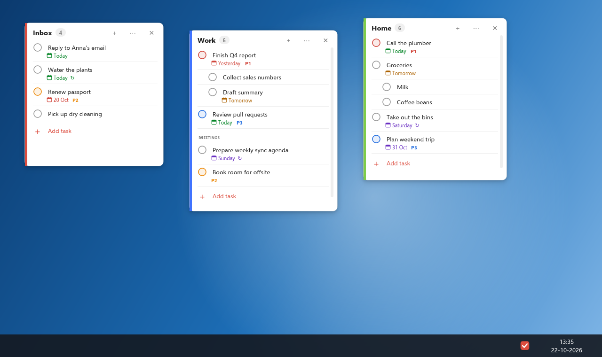
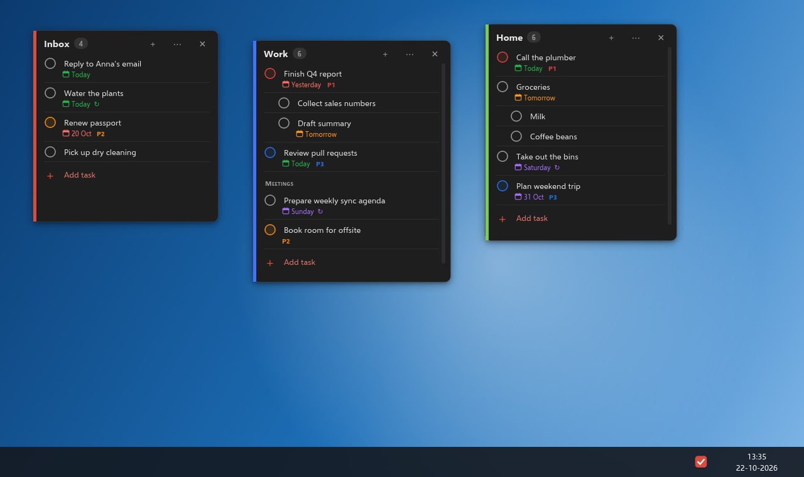
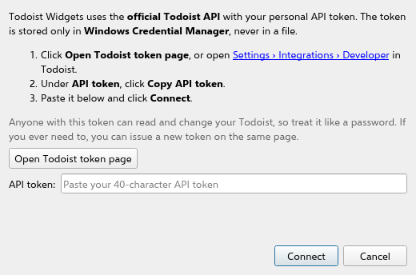

# Todoist Widgets

Your Todoist projects as small **task-card widgets** on the desktop (white or dark rounded cards with a soft shadow and a
Todoist project-colour accent bar). You get one
widget per project, or one per section. You can also add extra widgets for **Today**,
**Overdue** or a **label**. Tick tasks off, add tasks with Todoist's Quick Add syntax and edit
them right on the desktop. Changes sync both ways.



Dark theme (Settings → Theme):



*This app is not created by, affiliated with, or supported by Todoist.* It uses the
**official Todoist API v1** (`https://api.todoist.com/api/v1`) with your personal API token.

## Requirements

* Windows 10/11
* Python 3.11 or newer with the `py` launcher. If you don't have Python yet, install it with
  `winget install Python.Python.3.12`.

## Install

**Option 1: `install.bat`.** Double-click it. It will:

1. create a private virtual environment in `.venv`,
2. install the pinned packages from `requirements.txt`: PySide6-Essentials, requests and
   keyring,
3. add a Start Menu shortcut called **Todoist Widgets**,
4. ask whether to start with Windows. Run `install.bat /startup` to say yes without being asked,
   or `install.bat /quiet` to skip the question.

**Option 2: your system Python.** Run this one line:

```
py -m pip install -r requirements.txt
```

Then start the app with `run.bat`.

`run.bat` uses `.venv` if it exists. Otherwise it uses the system Python, as long as that Python
has the packages. It starts the app with `pythonw`, so no console window stays open.

## First start: connect Todoist



1. Open <https://app.todoist.com/app/settings/integrations/developer>. This is **Todoist >
   Settings > Integrations > Developer**. The **Open Todoist token page** button opens it too.
2. Click **Copy API token**.
3. Paste the token into the **Connect Todoist** window and click **Connect**. The app checks the
   token with Todoist before saving it.

The token is stored only in **Windows Credential Manager** (generic credential `TodoistWidgets`).
It is never written to a file and never logged. To remove it, use **Settings… > Sign out**. If
the token ever leaks, issue a new one on the same Todoist page.

## Using the widgets

| Do this | How |
|---|---|
| Complete a task | Click its round checkbox. The ring colour shows the priority: red P1, orange P2, blue P3 |
| Complete a recurring task | Same. Todoist moves it to the next date and the widget refreshes |
| Edit a task | Click the text, type, then press **Enter**. **Esc** cancels |
| Delete a task | Hover over it, click **✕** and confirm. Sub-tasks are deleted too |
| Add a task | Type in **+ Add task** and press Enter. Quick Add syntax works, for example `Call Anna tomorrow 10am p1 @phone` or `Plan trip #Home` |
| Move or resize a widget | Drag the header (project name), or the grip in the bottom-right corner |
| Accent colour, show completed, always on top | **⋯** menu on the widget |
| Hide a widget | **✕** in the header. Bring it back with tray **Show all widgets** |

* A task you add in a project widget goes into that project, or that section in section mode,
  unless you type your own `#Project`.
* A task you add in a label widget gets that label automatically.
* A task you add in the Today or Overdue widget goes to your Inbox. Add `today` to the text to
  give it a date.
* Sub-tasks are indented under their parent. Sections show as small headings.
* The due-date chip turns **red** when a task is overdue, shows **Today** or **Tomorrow**, and
  shows a weekday name for the coming week. **↻** marks recurring tasks.
* **Show completed** is off by default. When you turn it on, the widget lists tasks completed in
  the last 14 days, and you can untick them to reopen them.
* Every widget is **always on top** by default. You can turn this off per widget.
* The accent bar on the left follows the Todoist project colour (the official Todoist palette).
  Grey and charcoal projects use Todoist red. You can pick your own accent colour per widget (⋯ menu).
* Theme: **Light** (default) or **Dark**, chosen in Settings. Due dates use Todoist's colours:
  overdue red, today green, tomorrow orange, later purple.

### Tray icon menu

* **Status line:** shows "Synced 13:10 · Name". Otherwise it shows "Sync paused: … showing cached
  tasks" or "Not connected". It also says how many changes are still waiting to be sent.
* **Sync now**, **Show all widgets**, **Hide all widgets**, **Toggle all widgets**, **Quick add task…**, which adds to
  your Inbox
* **Settings…:**
  * one widget per project or per section
  * hide projects without open tasks
  * Today, Overdue and label widgets
  * sync interval (30–600 s, default 45 s)
  * change the token, sign out, open the data folder
* **Start with Windows:** adds or removes a shortcut in `shell:startup`.
* **Quit**

## Global hotkeys

Shortcuts that work in any program, set in **Settings > Global hotkeys** (click a field, press
the combination; the clear button removes it):

| Action | Default |
|---|---|
| Toggle all widgets (hide if any is visible, otherwise show all) | **Ctrl+Alt+T** |
| Show all widgets | none |
| Hide all widgets | none |

A shortcut needs at least two modifiers (for example Ctrl+Alt+…), a Win key combination, or
F13–F24. If Windows or another program already uses it, Settings tells you so and the shortcut
stays inactive until you pick another one. KeepNotes Widgets uses Ctrl+Alt+K, so the two apps
do not clash.

## How sync works

* The app uses Todoist's **incremental sync**. The first sync downloads everything. After that,
  each sync sends the last `sync_token` and only receives what changed. It syncs every 45 s and
  about 1.5 s after each edit.
* **Edits** are applied to the widget immediately and queued as Sync API commands: `item_close`,
  `item_uncomplete`, `item_update`, `item_delete` and `item_move`. Each command has a unique
  UUID, so a retry can never run twice.
* **Quick Add** uses `POST /api/v1/tasks/quick`, so Todoist itself parses dates, priorities,
  `#projects` and `@labels`.
* **Offline:** tasks are cached in `%APPDATA%\TodoistWidgets\state.json`. Queued edits survive a
  restart. The tray icon gets an orange pause badge and each widget shows "sync paused · N
  waiting". The queue is sent as soon as Todoist can be reached again.
* **Conflicts:** last write wins. If a task changed elsewhere at the same time, Todoist's version
  is kept, the conflict is logged and a tray notification appears. An edit to a task that was
  deleted elsewhere is dropped and logged.

## Files

| Where | What |
|---|---|
| `todoist_widgets.py` | The app: widgets, tray and dialogs (PySide6) |
| `todoist_sync.py` | The sync layer: Todoist API v1 client, offline queue and cache |
| `install.bat`, `run.bat`, `uninstall.bat`, `shortcut.ps1` | Install, start, uninstall and shortcut helpers |
| `win_hotkeys.py` | Global hotkeys (Win32 RegisterHotKey via ctypes, no extra packages) |
| `tests/`, `tools/make_screenshots.py` | Unit tests (a mocked Todoist API) and the headless UI test |
| `%APPDATA%\TodoistWidgets\layout.json` | Position, size, visibility, on-top and accent colour per widget, plus settings (including the theme) |
| `%APPDATA%\TodoistWidgets\state.json` | Offline cache and queued edits. No token |
| `%APPDATA%\TodoistWidgets\todoistwidgets.log` | Log file |

You can try the look without a token by running `run.bat --demo`.

## Uninstall

Quit the app from the tray, then run `uninstall.bat`. It removes the shortcuts and `.venv`. Your
tasks are not touched. To remove everything else, delete `%APPDATA%\TodoistWidgets` and the
`TodoistWidgets` entry in Credential Manager.

## Troubleshooting: nothing starts

If a start does nothing, check the log file in the data folder. Since this version a missing or
broken Python package shows a message box and writes `ERROR Startup failed` to the log instead
of exiting silently. A `.venv` folder left behind by an interrupted `install.bat` is skipped by
`run.bat` and the Start Menu shortcut; run `install.bat` again to repair it, or delete the `.venv`
folder to use your system Python.

## Limitations

* Task descriptions, comments, reminders, deadlines, durations and assignees are not shown. They
  are left untouched in Todoist.
* The Today and Overdue widgets are computed locally from due dates. Saved Todoist filters are
  not supported yet.
* Archived projects are not shown. Shared projects work like your own.
* "Show completed" fetches only the last 14 days, up to 200 tasks per project.
